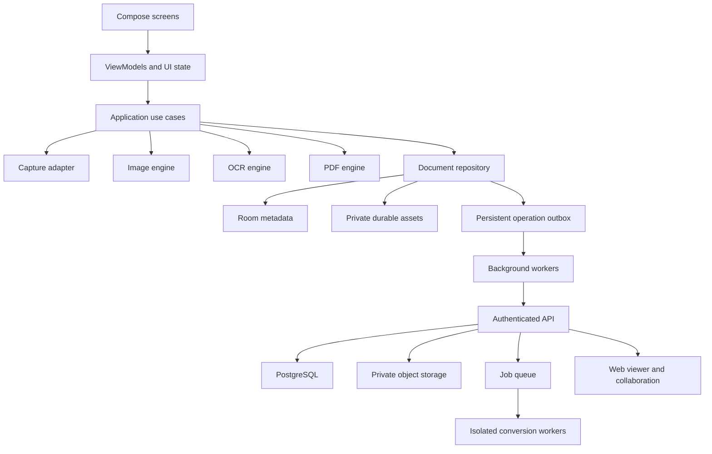

# Android Document Scanner: Architecture and Complete Build Procedure

Version: 1.1  
Prepared: 9 November 2026  
Target: an independently implemented Android scanner with the functional scope discussed for OKEN Scanner.  
Status: implementation blueprint; no application code has been built or tested by creating this document.

## 1. How to use this guide

Follow the numbered phases in order. Within each phase, complete the implementation checklist, run its verification, and satisfy its exit criteria before declaring it complete. Some independent work can overlap across developers, but dependency gates still apply.

Checked boxes must mean implemented and verified, not merely discussed. Keep test evidence with the corresponding issue or pull request. Record deliberate scope changes rather than silently dropping features.

This specification describes our proposed product. It does not claim to reproduce OKEN's private implementation or verify every advertised OKEN feature. Use original branding, artwork, text, and interface design. Where licensing affects a dependency, resolve that before distributing it.

**Product direction:** scan it clearly, find it quickly, submit it correctly. Sections 27–33 add required product improvements and the approved visual direction. Read them before starting the phases they extend; they are part of the implementation scope, not optional suggestions. The supplied shop-ledger theme is a visual reference adapted to document scanning, not a requirement to build accounting features.

### 1.1 Baseline decisions

| Decision | Baseline | Reason |
|---|---|---|
| First platform | Android | Matches the referenced app |
| Language/UI | Kotlin and Jetpack Compose | Native camera and document workflows |
| Architecture | Local-first, modular monolith | Core scanning works without an account |
| First capture prototype | ML Kit Document Scanner | Establish scan-quality baseline quickly |
| Custom capture option | CameraX and OpenCV | Full control if prototype cannot meet UX needs |
| OCR | On-device ML Kit initially | Avoid uploading routine scans |
| Local metadata | Room | Structured data, migrations, transactions |
| Local assets | App-private files | Durable originals separate from caches |
| Persistent background work | WorkManager | Retryable processing and synchronization |
| PDF engine | Selected through an early SDK proof of concept | Advanced editing cannot be assumed from a viewer |
| Backend | TypeScript API, PostgreSQL, private object storage | Clear ownership, revision and permission model |
| Conversion | Isolated server workers | Office rendering requires a layout engine |
| Web access | Responsive web viewer | Desktop access and shared links |
| Account requirement | Only for cloud/account features | Local documents remain usable offline |
| Theme | Green-black and warm gold, Material 3 | User-supplied visual direction; detailed tokens in section 30 |
| Default appearance | Dark, with Light and System choices | Persisted user preference |
| App text sizing | Small, Default, Large, Extra Large | App-wide scaling in addition to system accessibility settings |
| Product differentiators | Safe storage, submission presets, quality checks | Reduce lost work, rescans and failed submissions |

Do not fix dependency versions from this document. At implementation time, select mutually compatible supported releases from official documentation, pin them in a version catalog and lockfiles, and record the choices in an architecture decision record (ADR).

### 1.2 Release scope

- **R1 — Local scanner:** capture/import, crop, enhancement, multipage documents, durable saving, session recovery, page arrangement, PDF/JPG export, sharing and printing. Include the reference theme, all text sizes, local-save status, calm onboarding and accessible controls.
- **R2 — Local document suite:** OCR, search, TXT/basic DOCX, searchable PDF, folders/tags/trash, annotations, signatures, watermarks, merge/split/compression and protection. Include submission presets, size-targeted export, quality review, naming suggestions, local version history and task workflows.
- **R3 — Connected product:** accounts, backup/sync, cross-device access, links/comments/notifications, Office and website conversion, entitlements. Include explicit backup status, local-only restrictions and tested backup recovery.
- **R4 — Advanced parity:** existing-PDF content editing, layout-preserving conversion, broader tested OCR language support, receipt extraction and advanced book correction. Validate expensive features against a defined corpus before release.

All releases contribute to the requested scope. R1 is not a substitute for the complete product.

## 2. Feature inventory and traceability

Give each feature an issue with its ID, implementation owner, dependencies, acceptance tests, and release target.

| ID | Feature | Implementation location | Required proof |
|---|---|---|---|
| CAP-01 | Single-page scan | Capture | Capture, save and reopen |
| CAP-02 | Batch/multipage scan | Capture/session | Recover captured pages after process death |
| CAP-03 | Gallery import | Import | Multiple selected images imported in chosen order |
| CAP-04 | PDF/file import | Import/PDF | Imported source preserved and readable |
| CAP-05 | Auto boundary detection | Capture/image | Difficult-page benchmark and manual fallback |
| CAP-06 | Stable automatic capture | Custom capture, if selected | No repeated capture of unchanged page |
| CAP-07 | Flash/focus/manual capture | Custom capture | Works on devices with different capabilities |
| CAP-08 | ID front/back layout | Capture/layout | Correct placement and printable dimensions |
| CAP-09 | Passport capture | Capture/layout | Small text preserved without clipping |
| CAP-10 | QR reading | Barcode adapter | Decode and preview before opening |
| IMG-01 | Crop/perspective/rotate | Image engine | Original retained, geometry correct |
| IMG-02 | Color/gray/B&W presets | Image engine | Faint text retained in representative fixtures |
| IMG-03 | Brightness/contrast | Image editor | Edits reversible and repeatable |
| IMG-04 | Shadow/noise cleanup | Image engine | Quality improves without deleting content |
| DOC-01 | Add/delete/duplicate/reorder pages | Document | Stable page identities maintained |
| DOC-02 | Rename/folders/tags/move | Library | Metadata survives restart |
| DOC-03 | Multi-select and drag/drop | Library/editor | Correct target/order and accessible alternative |
| DOC-04 | Trash/restore/permanent delete | Library/storage | Restore is complete; purge respects shared assets |
| DOC-05 | Title and content search | Library/OCR | Results identify matching page |
| OCR-01 | Extract/copy/edit text | OCR | Accuracy measured by language |
| OCR-02 | TXT/basic DOCX export | Export | Opens in independent applications |
| OCR-03 | Searchable PDF | PDF/OCR | Search and copy Unicode correctly |
| PDF-01 | PDF/JPG creation | PDF/export | Page size, order and rotation correct |
| PDF-02 | PDF viewer | PDF | Large-file zoom/scroll without excessive memory |
| PDF-03 | Merge/split | PDF | Text/vector content retained where supported |
| PDF-04 | Compression | PDF | Size change measured; quality preview available |
| PDF-05 | Notes/text/highlights/drawing | Annotation | Editable persistence and export round-trip |
| PDF-06 | Electronic signature | Annotation | Correct placement after rotation/export |
| PDF-07 | Watermark | Annotation/export | Range, opacity and position correct |
| PDF-08 | Existing text/image editing | Advanced PDF | Real content modified, not merely covered |
| PDF-09 | Password-protected PDF | PDF/security | Independent reader accepts/rejects passwords correctly |
| SEC-01 | App/folder/file lock | Security | Defined access behavior; no plaintext preview leak |
| SHR-01 | Share attachment | Android integration | Recipient opens file using granted access |
| SHR-02 | Printing | Android integration | Print preview preserves page geometry |
| SHR-03 | Export to cloud apps | Android integration | Selected provider receives valid file |
| CNV-01 | DOC/DOCX to PDF | Conversion | Pagination and fonts compared |
| CNV-02 | XLS/XLSX/XLSM/CSV to PDF | Conversion | Sheets/print areas handled explicitly |
| CNV-03 | PPT/PPTX/PPTM to PDF | Conversion | Slides render; macros never execute |
| CNV-04 | Website to PDF | Conversion/browser | Safe URL handling and rendering limits |
| CLD-01 | Account login/recovery/deletion | Account/backend | All lifecycle transitions tested |
| CLD-02 | Backup/restore | Sync | Complete restore on another installation |
| CLD-03 | Cross-device sync | Sync | Offline conflicts preserve both edits |
| CLD-04 | Share links | Sharing/backend | Access, expiry and revocation enforced |
| CLD-05 | Comments/replies/activity | Collaboration | Correct document/page/version anchoring |
| CLD-06 | Notifications | Backend/client | Opening notification rechecks authorization |
| WEB-01 | Computer/tablet access | Web | Shared documents usable on supported browsers |
| PAY-01 | Subscriptions/restore/quotas | Entitlement | Server-verified state and cancellation behavior |
| PAY-02 | Ads/rewarded access, if chosen | Monetization | Failure cannot block saving a scan |

Image-to-PDF is covered by PDF-01. A format in an import list does not imply bidirectional conversion. Document each supported conversion direction explicitly.

Book flattening and layout-preserving Word conversion are R4 work with separate quality gates. Fax and certificate-based digital signatures remain optional unless explicitly requested. Ordinary book-page scanning does not establish curved-page dewarping; layout-preserving conversion must disclose fidelity limits rather than promise exact results for every input. Section 27 extends this inventory with all newly requested improvements.

## 3. System architecture



### 3.1 Dependency rules

1. Screens render state and emit user actions; they do not write files or execute SQL.
2. ViewModels coordinate use cases and expose immutable UI state.
3. Use cases implement operations such as save capture, reorder pages, export, and restore.
4. Repositories coordinate metadata and asset persistence.
5. Engine interfaces hide vendor-specific scanning, OCR, and PDF APIs.
6. Feature modules do not access another feature's private implementation.
7. Database entities and network DTOs are mapped to domain models at boundaries.
8. Expensive work stays off the UI thread and has cancellation/progress semantics.
9. Cloud availability must not determine whether an already-local document opens.
10. Jobs act on explicit document/page revisions, not whichever state happens to exist later.

### 3.2 Suggested repository layout

```text
repository/
  android/
    app/
    core/model/
    core/database/
    core/storage/
    core/security/
    core/designsystem/
    core/testing/
    domain/document/
    engine/capture/
    engine/image/
    engine/ocr/
    engine/pdf/
    data/documents/
    data/sync/
    feature/library/
    feature/capture/
    feature/editor/
    feature/ocr/
    feature/export/
    feature/account/
    feature/settings/
    gradle/libs.versions.toml
  backend/
    api/
    workers/conversion/
    migrations/
    tests/
  web/
  contracts/openapi.yaml
  fixtures/synthetic-documents/
  docs/adr/
  docs/test-plans/
  docs/release/
```

This is a logical target. Start with fewer Gradle modules if build complexity outweighs isolation; preserve these boundaries as packages and split modules when useful.

### 3.3 Core engine contracts

Define capabilities as well as methods. An unsupported feature must fail clearly rather than silently flattening or degrading a document.

```kotlin
// Illustrative contracts, not drop-in production code.
interface ImageEngine {
    suspend fun process(source: AssetId, recipe: EditRecipe): ProcessedAsset
}

interface OcrEngine {
    suspend fun recognize(input: OcrInput): OcrResult
}

interface PdfEngine {
    val capabilities: PdfCapabilities
    suspend fun export(request: PdfExportRequest): ExportResult
    suspend fun merge(request: MergeRequest): ExportResult
    suspend fun split(request: SplitRequest): List<ExportResult>
}

interface DocumentRepository {
    fun observe(id: DocumentId): Flow<DocumentSnapshot>
    suspend fun commitCapturedPage(request: CapturedPageRequest): PageId
    suspend fun applyEdit(request: EditDocumentRequest): DocumentRevision
}
```

Use typed identifiers, explicit failure types, and injected dependencies. Never pass a full bitmap or document file through navigation arguments or WorkManager input data; pass IDs and load assets in the operation.

## 4. Durable data design

### 4.1 Entities

| Entity | Essential fields |
|---|---|
| Document | id, title, folderId, kind, createdAt, updatedAt, revision, deletedAt |
| Page | id, documentId, position, sourceAssetId, sourcePdfPageIndex, recipeId, revision |
| Asset | id, relativePath, mediaType, byteSize, checksum, encryptionInfo, remoteKey, state |
| EditRecipe | id, schemaVersion, cropQuad, rotation, filter, adjustments |
| Annotation | id, pageId, type, normalizedGeometry, payload, style, revision |
| OcrResult | pageId, sourceRevision, engineVersion, language, text, positionedWords |
| Folder | id, name, parentId, createdAt, deletedAt |
| Tag / DocumentTag | id/name; documentId/tagId |
| CaptureSession | id, state, orderedPageIds, createdAt, lastActivityAt |
| BackgroundJob | id, type, inputRevision, state, progress, errorCode, attempts |
| OutboxOperation | id, entityId, operation, baseRevision, payload, status |
| RemoteMapping | localId, remoteId, serverRevision, syncState |
| Comment | id, documentId, pageId, documentRevision, anchor, parentId, text, author |

Store timestamps in UTC and localize display. Use generated stable IDs, not titles or filenames, as identity. Keep original PDFs intact and reference their pages; raster previews are disposable derivatives.

### 4.2 File layout

```text
files/
  assets/<asset-id>/original
  assets/<asset-id>/metadata
  documents/<document-id>/derived/<revision>/...
  staging/<operation-id>/...
cache/
  thumbnails/...
  temporary-share-exports/...
```

Document ownership lives in the database. Paths are implementation details. Store app-relative paths rather than installation-specific absolute paths. Copy imported content into durable ownership when necessary; external URI access can expire or be revoked.

### 4.3 Save protocol

1. Create a staging operation with a unique ID.
2. Stream the source to a staging file; enforce size limits and available-space checks.
3. Close and validate the file; compute its checksum.
4. Flush durable data where required by the chosen storage strategy.
5. Move the file to its final location on the same filesystem where atomic rename is available.
6. Commit asset/page records and session progress in a database transaction.
7. Mark the operation complete.
8. Schedule thumbnails, processing and OCR independently.
9. On startup, reconcile interrupted operations and unreferenced files.

Filesystem and database transactions are not one atomic transaction. Recovery logic must handle both a file without a database row and an unfinished database operation. Never display 'Saved' before the durable source and metadata are committed.

### 4.4 Edit and deletion rules

- Original assets are immutable; modifications create recipes or new revisions.
- The document revision changes when page composition or relevant content changes.
- OCR/thumbnail/export outputs record their source revision.
- A stale job may retain its output as a cache but must not replace the current revision's output.
- A duplicated page may share an immutable source asset; deleting one page must not delete a still-referenced asset.
- Trash changes metadata first. Permanent cleanup occurs only after reference checks and synchronization rules are satisfied.
- Sync deletion uses tombstones, retained long enough to prevent old devices from resurrecting deleted records.

## 5. Phase 0 — Define requirements and run technical prototypes

### Implement

- [ ] Create issues from the feature inventory.
- [ ] Define supported Android/device classes and choose the minimum SDK after SDK evaluation.
- [ ] Record current target-SDK and store requirements when preparing a release.
- [ ] Create synthetic fixtures: printed text, faint receipt, handwriting, table, colored page, curved book page, identity-card mockup and rotated scan.
- [ ] Prototype ML Kit scanning on at least one low/mid-range physical phone.
- [ ] Decide whether its UI and outputs satisfy the desired capture flow.
- [ ] If custom capture is required, prototype CameraX capture plus manual crop before advanced detection.
- [ ] Evaluate PDF SDK candidates using the same corpus.
- [ ] Test viewing, merging, splitting, annotations, password encryption, Unicode searchable export and existing-content editing separately.
- [ ] Confirm licensing, redistribution, offline operation and required paid modules.
- [ ] Record an ADR for capture, OCR, PDF engine, storage, account model and backend.

### Verify and exit

- [ ] Produce actual sample scans and PDFs, not only vendor demonstrations.
- [ ] Open exported samples in independent PDF readers.
- [ ] Document unsupported features and chosen alternatives.
- [ ] Select the PDF engine before implementing its full UI.
- [ ] Approve a measurable release scope and retain all deferred features in the backlog.

## 6. Phase 1 — Set up the development environment and project

### Implement

- [ ] Install Android Studio, its compatible JDK, Android SDK tools and emulator images.
- [ ] Enable developer options/USB debugging on a test phone.
- [ ] Create a Kotlin/Compose Android application under `android/`.
- [ ] Select an original application ID and display name.
- [ ] Commit the Gradle wrapper and version catalog.
- [ ] Configure debug, staging and release environments with separate backend settings.
- [ ] Keep signing keys, service credentials and production secrets outside source control.
- [ ] Add code formatting, static analysis and unit/instrumentation test infrastructure.
- [ ] Add dependency injection and typed application error handling.
- [ ] Create the database, asset store and repository boundaries.
- [ ] Add navigation routes using IDs rather than serialized documents.
- [ ] Add loading, empty, error, permission-denied and offline UI components.
- [ ] Establish accessibility labels, touch-target sizing, scalable text and contrast standards.

### Verify and exit

- [ ] Debug app builds from a fresh checkout.
- [ ] App starts on an emulator and a physical phone.
- [ ] CI runs without developer-local paths or secrets.
- [ ] Rotation and process recreation do not crash the empty application.

Example PowerShell commands after the project exists:

```powershell
Set-Location ./android
.\gradlew.bat assembleDebug
.\gradlew.bat testDebugUnitTest
.\gradlew.bat lintDebug
.\gradlew.bat connectedDebugAndroidTest
```

Task names may need module qualification or adjustment for the selected build variants. The connected test task requires an available emulator/device.

## 7. Phase 2 — Implement storage and a minimal library

### Implement

- [ ] Implement Document, Page, Asset and CaptureSession entities and constraints.
- [ ] Add explicit database migrations from the first released schema onward.
- [ ] Implement the staged-save protocol and startup reconciliation.
- [ ] Create repository operations for new document, append page, rename and open.
- [ ] Display an empty library and a list of stored documents.
- [ ] Generate thumbnails off the main thread and cache them independently.
- [ ] Add document details: title, page count, last modification and processing state.
- [ ] Import one synthetic image through the repository as the first vertical slice.
- [ ] Implement app-owned copies for imports that need durable access.

### Verify and exit

- [ ] Save/import, force-stop, restart, and reopen the document.
- [ ] Inject failure before/after each save boundary and verify recovery.
- [ ] Verify low-storage failures produce an actionable error without corrupting existing documents.
- [ ] Verify deleting caches cannot delete originals.
- [ ] Test migration from every released schema fixture; do not use destructive migration as a production fallback.

## 8. Phase 3 — Implement capture and import

### Route A: managed scanner

- [ ] Launch ML Kit's document-scanner flow through its supported Android integration.
- [ ] Configure gallery import, allowed page count, output formats and scan mode.
- [ ] Handle cancellation, resource download, unsupported-device and service-unavailable cases.
- [ ] Copy returned page assets into the app's durable storage promptly.
- [ ] Build the app's document model from returned pages rather than retaining only a flattened PDF.
- [ ] Verify what source/edit information the API actually exposes; do not promise recovery of an original it never returns.

### Route B: custom camera

- [ ] Bind CameraX Preview, ImageCapture and ImageAnalysis to the screen lifecycle.
- [ ] Add manual capture first, then flash and focus controls where hardware supports them.
- [ ] Use low-resolution analysis frames with backpressure so slow analysis cannot queue unlimited frames.
- [ ] Close analysis images on every completion/error path.
- [ ] Map preview, sensor, rotation, crop and final-image coordinates explicitly.
- [ ] Add a document-boundary overlay and confidence indicator.
- [ ] Add stability, minimum size and visibility checks before automatic capture.
- [ ] Add cooldown/page-change logic to prevent duplicate automatic captures.
- [ ] Preserve manual capture even when detection confidence is low.
- [ ] Use supported analyzer integrations such as MlKitAnalyzer when integrating compatible ML Kit detectors.

### Common workflow

- [ ] Persist each successful capture immediately into a capture session.
- [ ] Show thumbnail, page count, retake/remove and finish controls.
- [ ] Allow cancellation without unexpectedly destroying completed pages.
- [ ] Add gallery multi-selection and Android file-picker imports.
- [ ] Validate actual media content, not just filename extension.
- [ ] Normalize EXIF orientation and record image dimensions.
- [ ] Handle unsupported and password-protected PDFs explicitly.

### Verify and exit

- [ ] Complete a ten-page document on a physical phone.
- [ ] Recover pages after killing the process halfway through capture.
- [ ] Test permission denial, permission revocation, no flash, autofocus variation and orientation changes.
- [ ] Test rotated gallery images and large image imports.
- [ ] Confirm the library shows durable pages even if thumbnail generation fails.

## 9. Phase 4 — Implement page correction and enhancement

### Implement

- [ ] Define a versioned EditRecipe schema.
- [ ] Add four-corner crop handles, magnification, reset and rotation.
- [ ] Prevent invalid/self-intersecting crop quadrilaterals.
- [ ] Normalize coordinates relative to source dimensions.
- [ ] Calculate perspective transformation and render a corrected page.
- [ ] Add original/color/grayscale/B&W presets.
- [ ] Add brightness and contrast with bounded ranges.
- [ ] Add conservative shadow/noise correction and an original/result comparison.
- [ ] Process a reduced preview while editing; process full resolution on commit/export.
- [ ] Add undo/redo for recipe changes.
- [ ] Record pipeline version so old recipes can be reproduced or migrated.
- [ ] Invalidate only affected derivatives after edits.

### Verify and exit

- [ ] Check synthetic corner markers after transformation.
- [ ] Verify previews and exported pages have identical geometry.
- [ ] Verify crop/rotation combinations on portrait and landscape images.
- [ ] Compare faint text, signatures and stamps before/after enhancement.
- [ ] Confirm original bytes remain unchanged after repeated edits.
- [ ] Measure memory with large images and avoid retaining multiple full-size copies unnecessarily.

## 10. Phase 5 — Build the document editor and special modes

### Implement

- [ ] Add page grid, selection and accessible reorder controls.
- [ ] Implement append, insert, duplicate, delete, retake and rotate.
- [ ] Persist page ordering transactionally and preserve page IDs.
- [ ] Add ID front/back capture with page-layout preview and configurable output page size.
- [ ] Add passport guides without altering small text.
- [ ] Integrate QR decoding; show decoded content and ask for a tap before opening external destinations.
- [ ] Add rename, folders, tags, sorting, multi-select and move operations.
- [ ] Add trash, restore and explicit permanent-delete behavior.
- [ ] Add nested-folder cycle prevention if nested folders are supported.

### Verify and exit

- [ ] Reordering does not change annotation/OCR page associations.
- [ ] Duplicating then deleting a page does not remove a shared source asset.
- [ ] ID layouts print at intended dimensions with margins preserved.
- [ ] QR cancellation/invalid input does not interrupt the document workflow.
- [ ] Restore returns every original, recipe and annotation needed to reopen the document.

## 11. Phase 6 — Implement export, sharing and printing

### Implement

- [ ] Define an ExportRequest using an immutable document revision snapshot.
- [ ] Support PDF and individual JPG outputs.
- [ ] Support page range, page size, orientation, margins and image quality.
- [ ] Render/export page by page rather than decoding an entire document into memory.
- [ ] Write to staging and expose only a validated completed output.
- [ ] Display progress, cancellation and retry actions.
- [ ] Use a content URI and temporary read grants for Android sharing.
- [ ] Support user-selected save destinations through Android storage APIs.
- [ ] Integrate printing and verify its layout preview.
- [ ] Expire temporary share files conservatively; do not delete while a recipient is still reading.
- [ ] Reuse cached exports only when revision and export options match.

### Verify and exit

- [ ] Open a ten-page export in at least two independent readers.
- [ ] Verify page count, order, dimensions, rotation and readability.
- [ ] Share to messaging, email and an installed cloud provider.
- [ ] Cancel a long export and confirm no corrupt file is advertised as complete.
- [ ] Test export with low storage and revoked destination access.
- [ ] Print-preview a mixed-orientation document.

**R1 gate:** capture/import ten pages, correct/reorder them, restart, reopen and export successfully without an account or network after required scanner resources are available. Test first-use resource unavailability separately.

## 12. Phase 7 — Implement OCR and searchable documents

### Implement

- [ ] Define supported scripts/languages based on actual recognizer support.
- [ ] Decide bundled versus downloaded models and communicate model availability.
- [ ] Store recognized text, reading order and word/line geometry against page revision.
- [ ] Run recognition on corrected images with controlled resolution.
- [ ] Add text review, editing, copying and TXT export.
- [ ] Add a local full-text search index linked to stable page/document IDs.
- [ ] Reindex modified pages and remove deleted content from active search results.
- [ ] Generate searchable PDFs with aligned invisible text, suitable fonts and Unicode mappings.
- [ ] Add basic DOCX export from text paragraphs; label it as basic formatting preservation.
- [ ] Treat layout-preserving Word export as an additional engine integration and benchmark.
- [ ] If local scripts are insufficient, evaluate an additional recognizer; any server fallback requires an explicit upload UX.

### Verify and exit

- [ ] Maintain ground-truth text for representative fixtures and measure character/word error rates.
- [ ] Report results separately by script and document type rather than one misleading average.
- [ ] Verify search, selection and copying from exported PDFs in independent readers.
- [ ] Test rotated pages, multiple columns, tables, faint print and mixed languages.
- [ ] Confirm stale OCR does not attach to a newly edited page revision.
- [ ] Test model absent, download failed and offline recognition states.

## 13. Phase 8 — Add annotations and advanced PDF operations

### Implement

- [ ] Add text notes, freehand ink, shapes and highlights with undo/redo.
- [ ] Store normalized geometry and transform it consistently through zoom/rotation.
- [ ] Add drawn/imported signatures with transparent background handling.
- [ ] Add watermark controls for content, opacity, rotation and page range.
- [ ] Export editable annotations where supported and offer flattening as an explicit choice.
- [ ] Implement merge and split using PDF structures rather than image conversion.
- [ ] Preserve text, vectors and metadata where supported; report unsupported constructs.
- [ ] Implement compression presets and show resulting size and quality preview.
- [ ] Avoid increasing file size silently; allow retaining the original when compression is ineffective.
- [ ] Add PDF password encryption using the selected engine's supported secure configuration.
- [ ] Add existing text/image editing only if the engine actually supports it.
- [ ] Distinguish annotation, OCR correction, existing-content editing and redaction in UI and tests.
- [ ] Do not call a black rectangle 'redaction'; true redaction must remove underlying information.

### Verify and exit

- [ ] Export/reimport annotations and verify coordinates and editability.
- [ ] Merge mixed scanned/vector PDFs without discarding searchable text.
- [ ] Test split ranges, duplicate pages, encrypted files and damaged input.
- [ ] Test non-Latin text, embedded fonts and rotated pages.
- [ ] Verify password behavior in independent readers.
- [ ] Check signatures remain correctly placed after page edits.

## 14. Phase 9 — Implement local protection and privacy behavior

### Implement

- [ ] Define app lock, folder/file lock and encryption as separate capabilities.
- [ ] Use platform-backed key management and reviewed authenticated-encryption APIs.
- [ ] Never derive an encryption key directly from a short PIN without a considered key-derivation and recovery design.
- [ ] Define biometric/device-credential fallback and lock timeout behavior.
- [ ] Protect originals, thumbnails, OCR text, indexes and temporary files consistently.
- [ ] Decide whether protected content appears in search or recent-app previews.
- [ ] Define how keys and encrypted assets behave after reinstall, device loss and backup restore.
- [ ] Keep document text and images out of telemetry and crash attachments.
- [ ] Request permissions only for active features; avoid contacts/location for ordinary scanning.
- [ ] Ensure privacy disclosures describe actual SDKs and data flows.

### Verify and exit

- [ ] Inspect logs, cache, backups and temporary exports for unintended plaintext.
- [ ] Test wrong credentials, biometric changes and device-lock changes.
- [ ] Prove backup restoration can recover keys where promised.
- [ ] Confirm account logout does not accidentally erase unrelated local documents.

**R2 gate:** the local document suite is usable offline within documented model/engine constraints, with recoverable storage and validated exports.

## 15. Phase 10 — Implement accounts and backend foundations

### Implement

- [ ] Create development/staging/production infrastructure with separate data and credentials.
- [ ] Define the API in OpenAPI before connecting screens.
- [ ] Use a supported authentication provider or reviewed authentication implementation.
- [ ] Implement registration/login, token renewal, logout, recovery and deletion.
- [ ] If phone/WhatsApp OTP is required, integrate an authorized provider with rate limits, retry limits and recovery; do not assume email login provides OTP delivery.
- [ ] Enforce document ownership and permissions server-side on every request.
- [ ] Store objects privately; generate short-lived authorized upload/download URLs.
- [ ] Set quotas, MIME validation, upload limits and checksums.
- [ ] Add database migrations, health checks, structured errors and request correlation IDs.
- [ ] Add backup and restore procedures for metadata and object storage.

### Suggested API surface

| Endpoint | Purpose |
|---|---|
| `POST /v1/uploads` | Authorize and create an upload session |
| `POST /v1/uploads/{id}/complete` | Validate/finalize uploaded asset |
| `POST /v1/documents` | Create document with idempotency key |
| `GET /v1/documents/{id}` | Retrieve authorized metadata/revision |
| `PATCH /v1/documents/{id}` | Apply edit against expected base revision |
| `DELETE /v1/documents/{id}` | Create deletion/tombstone operation |
| `GET /v1/changes?cursor=...` | Incremental synchronization |
| `POST /v1/conversions` | Submit conversion job |
| `GET /v1/jobs/{id}` | Read job status and authorized result |
| `POST /v1/documents/{id}/shares` | Create scoped share |
| `DELETE /v1/shares/{id}` | Revoke share |
| `POST /v1/documents/{id}/comments` | Add authorized anchored comment |
| `GET /v1/entitlements` | Read server-verified feature access |
| `POST /v1/account/deletion` | Begin account deletion workflow |

### Verify and exit

- [ ] Attempt cross-account access to every resource type and verify denial.
- [ ] Verify expired/revoked sessions and unauthorized object access fail.
- [ ] Test replayed create/upload requests for idempotency.
- [ ] Restore staging from backups and prove metadata points to available assets.

## 16. Phase 11 — Implement backup and synchronization

### Synchronization procedure

1. Commit the local change and its outbox operation in one database transaction.
2. Schedule eligible background synchronization.
3. Upload required immutable assets and verify completion.
4. Submit metadata changes with operation ID and base server revision.
5. Server authorizes, validates and commits once, even if retried.
6. Server returns a new revision and change cursor.
7. Client records acknowledgement and removes/completes the outbox entry transactionally.
8. Pull remote changes using an opaque server cursor.
9. Apply changes transactionally and fetch required assets.
10. Expose pending, syncing, failed and synced status accurately.

### Implement

- [ ] Retry transient failures with bounded backoff; distinguish permanent authorization/quota failures.
- [ ] Support network/battery constraints without claiming a guaranteed immediate background schedule.
- [ ] Preserve conflicts as separate versions initially; never silently discard edits.
- [ ] Define guest-document association when a user signs in.
- [ ] Define behavior when switching accounts on the same device.
- [ ] Separate 'backed up' from 'upload scheduled'.
- [ ] Include originals, recipes, annotations, page order and recoverable key information in a complete backup design.
- [ ] Apply deletions with tombstones and a documented retention policy.
- [ ] Reconcile uploads that succeeded remotely but whose acknowledgement was lost.

### Verify and exit

- [ ] Edit the same document on two offline devices, reconnect, and retain both versions.
- [ ] Interrupt uploads and retry without duplicates or broken documents.
- [ ] Test incorrect device clocks; use revisions/cursors instead of clock order for correctness.
- [ ] Delete on one device while editing on another and verify the documented conflict policy.
- [ ] Restore a complete document collection on a fresh installation.

## 17. Phase 12 — Implement sharing, collaboration and web access

### Implement

- [ ] Build a responsive viewer for authorized documents.
- [ ] Support owner/viewer/commenter/editor permissions as explicit server rules.
- [ ] Use opaque high-entropy share tokens and optional expiry.
- [ ] Define whether each link exposes a snapshot or the current document revision.
- [ ] Recheck permission on every content request; a hidden UI button is not authorization.
- [ ] Implement revocation and bound any residual access from previously issued download URLs.
- [ ] Add comments/replies anchored to stable page IDs and revisions.
- [ ] Handle removed pages and outdated comment anchors explicitly.
- [ ] Generate activity events after successful commits.
- [ ] Send push notifications without sensitive document text by default.
- [ ] Recheck authorization when opening notification deep links.
- [ ] Start with asynchronous comments; simultaneous content editing is a separate concurrency feature.

### Verify and exit

- [ ] Test every permission role and revoked/expired links.
- [ ] Test unauthorized browser sessions and direct asset URL attempts.
- [ ] Reorder/delete pages and verify comment association behavior.
- [ ] Test mobile and desktop browsers, keyboard navigation and large documents.

## 18. Phase 13 — Implement Office and website conversion

### Implement

- [ ] Define an explicit conversion matrix for each accepted input and output.
- [ ] Run conversions in isolated workers, never in the API request process.
- [ ] Assign a separate workspace/profile to each conversion job.
- [ ] Disable macros and unnecessary external-resource fetching.
- [ ] Apply CPU, memory, time, file-size and decompression limits.
- [ ] Install approved fonts and document font-substitution behavior.
- [ ] Use LibreOffice headless or a selected licensed engine for Office-to-PDF.
- [ ] Provide spreadsheet sheet/print-area handling and presentation slide selection where supported.
- [ ] Validate output structure and page count; process exit status alone is insufficient.
- [ ] Keep job status persistent and make submission idempotent.
- [ ] Expire source/output temporary objects under a documented retention policy.
- [ ] For website conversion, allow only supported URL schemes and reject private/internal destinations.
- [ ] Revalidate redirects and resolved destinations; isolate browser network access against SSRF and DNS rebinding.
- [ ] Set a render timeout and explain limitations for authenticated/dynamic sites.
- [ ] Make upload and online-processing behavior visible before conversion starts.

### Verify and exit

- [ ] Compare representative Word, Excel, CSV and PowerPoint results visually.
- [ ] Test macros, encrypted inputs, corrupt files, huge sheets, font gaps and embedded objects.
- [ ] Test worker crash/retry and verify no duplicate billing/quota deduction.
- [ ] Test malicious URLs, redirects to internal services and oversized downloads.
- [ ] Verify temporary-file expiration and account deletion cleanup.

## 19. Phase 14 — Implement entitlements and optional advertisements

### Implement

- [ ] Define a feature/plan matrix before adding paywalls.
- [ ] Integrate the applicable supported store billing flow.
- [ ] Verify purchases on the backend using the store's supported verification APIs.
- [ ] Handle pending purchases, acknowledgement, renewal, cancellation, expiry, refund and restore.
- [ ] Treat client entitlement caches as temporary convenience, not server authorization.
- [ ] Define offline grace behavior and cloud quota enforcement.
- [ ] Keep existing local documents readable/exportable under the product's ownership policy.
- [ ] If ads are included, isolate the SDK and keep capture/save transactions independent.
- [ ] Verify rewarded grants and define behavior when ads are unavailable.
- [ ] Update SDK inventory and privacy disclosures for actual monetization behavior.

### Verify and exit

- [ ] Use store test accounts and test renewal/expiry/restore scenarios.
- [ ] Confirm fake client premium flags cannot unlock paid server operations.
- [ ] Ensure cancelled subscriptions do not delete user documents.
- [ ] Verify missing ad/network services cannot lose a captured page.

## 20. Test strategy and release evidence

### 20.1 Test layers

| Layer | Test targets | Approach |
|---|---|---|
| Unit | Geometry, recipes, page order, revision checks, quotas | Deterministic fixtures and fakes |
| Repository | Save/recovery, reference handling, migrations | Temporary storage and real test database |
| Engine integration | OCR, PDF, image processing | Representative golden corpus |
| Android UI | Navigation, editing, permission states | Instrumented Compose tests |
| Physical device | Camera, memory, thermal, interruption | Repeatable manual/device scenarios |
| Backend | Auth, object access, jobs, idempotency | Isolated test services |
| Sync | Two devices, conflicts, retries | Simulated networks plus integration tests |
| End-to-end | Capture to export/cloud restore | Staging environment |
| Security | Access control, file/URL processing, key lifecycle | Focused adversarial tests |

Prefer stateful fakes over deeply mocked camera/storage objects. For Android tests, configure explicit test runners and clear assertions. Test meaningful behavior rather than duplicating implementation details.

### 20.2 Mandatory regression scenarios

| Test ID | Scenario | Expected outcome |
|---|---|---|
| T-001 | Kill process after page 5 of 10 | Five durably saved pages recover |
| T-002 | Storage fills during save | Clear failure; existing files remain valid |
| T-003 | Storage fills during export | No completed/corrupt export advertised |
| T-004 | Rotate during capture/editor | Correct state and coordinate mapping |
| T-005 | Permission revoked | Recoverable permission UI |
| T-006 | Reorder after OCR/annotations | Associations follow stable page IDs |
| T-007 | Export while editing | Export uses its defined snapshot consistently |
| T-008 | Delete duplicated page | Other page retains original asset |
| T-009 | OCR result arrives after new edit | Stale result cannot replace current OCR |
| T-010 | Upload acknowledgement lost | Retry produces one logical operation |
| T-011 | Concurrent offline changes | Both edits preserved under conflict policy |
| T-012 | Revoke shared link | Subsequent access denied within defined bounds |
| T-013 | Restore on new installation | Originals, edits and annotations recover |
| T-014 | Subscription expires | Existing local documents remain accessible |
| T-015 | Wrong PDF password | Independent reader rejects access |
| T-016 | Database upgrade | Prior released data remains intact |
| T-017 | Account switches | No cross-account data leakage |
| T-018 | Conversion worker dies | Retry or clear failure without orphaned public output |

### 20.3 Device and document matrix

- Lowest supported Android version, an intermediate version and current target devices.
- Low-memory and mid-range physical phones, plus a modern high-end phone.
- At least two camera vendors/configurations; tablet/foldable if supported.
- Portrait/landscape, large fonts, dark theme, screen reader and keyboard navigation.
- No network, poor network, metered network, low battery and low storage.
- Clean print, faint receipts, handwriting, stamps, tables, colored paper, glossy cards and book pages.
- Single-page, ten-page and hundred-page documents; more if the product claims it.
- Scanned PDFs, vector PDFs, encrypted PDFs, damaged PDFs and embedded-font PDFs.

### 20.4 Performance measurement

First measure on named reference devices, then set numerical budgets in `docs/test-plans/performance.md`. Do not advertise universal timings from a developer workstation.

Measure camera startup, capture-to-durable-save time, preview latency, full-page processing, OCR latency, export duration, thumbnail scrolling, peak memory, battery/thermal behavior and file size.

Use thumbnails for library grids, render PDF pages on demand, bound caches, release native image/PDF resources, and avoid decoding all pages simultaneously. Test cancellation cleanup. Add profiling only when measurements identify a bottleneck or a release budget fails.

## 21. CI/CD procedure

### Every pull request

1. Check formatting and static analysis.
2. Compile affected applications/modules.
3. Run unit and repository tests.
4. Run database migration tests for schema changes.
5. Run affected engine/integration tests.
6. Scan for accidentally committed secrets and review dependency changes.
7. Publish test reports and relevant artifact comparisons.

### Nightly or scheduled integration run

1. Run emulator UI tests and representative end-to-end flows.
2. Run the document conversion corpus.
3. Run multi-client synchronization scenarios.
4. Compare performance/quality against recorded baselines.
5. Flag regressions rather than silently refreshing golden outputs.

### Release candidate

1. Build signed release artifacts in a controlled environment.
2. Verify release-only behavior, optimization rules and native dependencies.
3. Test installation over the last public version with existing documents.
4. Run physical-device capture/export/recovery smoke tests.
5. Verify current store target-SDK, permission, billing and account-deletion requirements against official policy.
6. Reconcile privacy disclosures with the actual release dependency inventory and traffic.
7. Upload to internal testing and obtain release evidence.
8. Stage rollout and monitor failures before expanding availability.

## 22. Operational readiness

- [ ] Monitor crash/ANR rates and document-save/export failure counts.
- [ ] Monitor conversion queue age, failures, worker resource use and storage growth.
- [ ] Record sync conflict and retry rates without logging document content.
- [ ] Keep support diagnostics opt-in and redact filenames/text where practical.
- [ ] Test database/object-store restoration periodically.
- [ ] Define incident handling for save failures and missing-file reports.
- [ ] Keep feature switches for new cloud features without disabling local document access.
- [ ] Use backward-compatible API changes and staged database migrations.
- [ ] Define minimum compatible client versions carefully; forced upgrades must not strand local data.
- [ ] Account deletion must cover database records, object storage, temporary conversions and documented backup-retention behavior.
- [ ] Deleting caches, logging out and deleting an account must have different, explicit effects.

## 23. Advanced extensions and scope boundaries

### Book dewarping

Required in R4: build a separate benchmark for curved pages. Evaluate a trained model or specialized SDK, test gutter distortion and text preservation, and keep a manual fallback. Perspective correction is insufficient for curved surfaces. Preserve originals and provide split-spread previews; never silently reconstruct or invent text.

### Layout-preserving Word conversion

Required in R4: evaluate a dedicated conversion engine against columns, tables, headers, footers and non-Latin text. Publish fidelity limits. Basic OCR-to-DOCX does not satisfy this requirement.

### Certificate-based digital signatures

Specify certificate provisioning, private-key protection, timestamping, validation and how later edits affect signature validity. Keep this distinct from a drawn signature image.

### Fax

Only add if required. Integrate a fax provider, destination validation, pricing, delivery status, retries and failure/refund behavior. Printing and sharing do not implement fax.

## 24. Definition of done for the complete product

- [ ] Every in-scope feature ID has an implementation and passing acceptance evidence.
- [ ] No placeholder controls or silent unsupported operations remain in released flows.
- [ ] Core scanning and access to local documents work under documented offline constraints.
- [ ] Save/recovery tests pass; cache cleanup cannot erase originals.
- [ ] Export correctness is verified independently of the app's own viewer.
- [ ] Supported OCR languages have measured results and honest limitations.
- [ ] Advanced PDF claims match actual engine capabilities.
- [ ] Cloud permissions and cross-account isolation pass tests.
- [ ] Backup/restore and synchronization conflicts have been exercised end to end.
- [ ] Conversion workers handle hostile/oversized input within defined resource limits.
- [ ] Subscription changes do not destroy user-owned documents.
- [ ] Accessibility, device compatibility and performance budgets pass.
- [ ] Dependency licenses, privacy disclosures and current store requirements are resolved.
- [ ] Release rollback, support diagnostics and restore procedures are documented.
- [ ] All improvement IDs in section 27 have their release-specific acceptance evidence.
- [ ] Dark/light themes, all four app text sizes, and system font scaling pass section 32.
- [ ] Submission constraints, quality warnings and backup labels are derived from actual results.
- [ ] Local-only mode and premium transitions obey the document-ownership rules.

## 25. Recommended first ten implementation tasks

1. Create the Android project and get a clean build on a physical device.
2. Run scan and PDF-engine prototypes; record decisions.
3. Implement Document/Page/Asset entities and the asset store.
4. Implement staged save and recovery tests.
5. Import one image into the library and reopen it after restart.
6. Connect capture to the same durable-save path.
7. Add crop/rotation and persist a reversible recipe.
8. Build a ten-page editor with stable reordering.
9. Export PDF/JPG and validate with independent applications.
10. Kill the process at save/export boundaries and fix recovery before adding cloud features.

## 26. Official references

These references informed the architecture. Recheck current API compatibility and policies when implementing; this document deliberately avoids hard-coded dependency versions.

- [CameraX architecture](https://developer.android.com/media/camera/camerax/architecture)
- [ML Kit Document Scanner overview](https://developers.google.com/ml-kit/vision/doc-scanner)
- [ML Kit Document Scanner Android integration](https://developers.google.com/ml-kit/vision/doc-scanner/android)
- [ML Kit OCR language support](https://developers.google.com/ml-kit/vision/text-recognition/v2/languages)
- [Room local persistence](https://developer.android.com/training/data-storage/room)
- [WorkManager persistent background tasks](https://developer.android.com/develop/background-work/background-tasks/persistent)
- [OpenCV geometric transformations](https://docs.opencv.org/4.x/da/d54/group__imgproc__transform.html)
- [Android PdfRenderer reference](https://developer.android.com/reference/android/graphics/pdf/PdfRenderer)
- [Nutrient Android SDK](https://www.nutrient.io/sdk/android/)
- [LibreOffice command-line operation](https://help.libreoffice.org/latest/en-US/text/shared/guide/start_parameters.html)

For each dependency selected later, add the exact version, license, supported Android/API range, required modules and tested capabilities to its ADR. Keep the feature inventory and acceptance evidence synchronized with implementation changes.

## 27. Required product improvements and release mapping

These extend the original feature IDs. Where they overlap an existing feature, share implementation and tests rather than building a second system.

| ID | Improvement | Release | Extends | Completion evidence |
|---|---|---|---|---|
| IMP-01 | Visible document safety, recovery, version history | R1 foundation; R2 history; R3 backup | CAP-02, DOC-04, CLD-02 | Interrupted scan and old-revision restore succeed |
| IMP-02 | Ready-to-submit export and reusable presets | R2 | PDF-01, PDF-04, SHR-01 | Actual output satisfies selected constraints or explains failure |
| IMP-03 | Page-quality checks and guided retakes | R2 | IMG-01 through IMG-04 | Measured detection quality and user override |
| IMP-04 | Long-session scanning and selective corrections | R1 foundation; R2 complete | CAP-02, CAP-06, DOC-01 | Thirty-page session completes and resumes |
| IMP-05 | Understandable local-only privacy mode | R1/R2 local; R3 network gate | SEC-01, CLD-02 | Network-dependent content operations blocked before upload |
| IMP-06 | Suggested naming, organization, duplicate detection and search | R2 | DOC-02, DOC-05, OCR-01 | Suggestions accepted/rejected; matches open correct page |
| IMP-07 | Assignment/application/receipt/sign/ID workflows | R2; R4 advanced receipt extraction | CAP-08, PDF-06, SHR-01 | End-to-end task tests pass |
| IMP-08 | Honest OCR review and language-quality reporting | R2/R4 | OCR-01 through OCR-03 | Corrections persisted without false accuracy claims |
| IMP-09 | Calm UI, transparent pricing, document ownership | R1; R3 monetization | PAY-01, PAY-02 | No forced login or surprise export paywall |
| UX-01 | Green-black/gold dark and light themes | R1 | All screens | Token and screen verification matrix passes |
| UX-02 | App-wide text sizes and accessibility | R1 | All screens | No clipped critical content at tested scales |
| UX-03 | English-first localization with Urdu/RTL readiness | R1 structure; Urdu when translated/tested | All screens | RTL fixtures and script rendering pass |

### 27.1 New architectural responsibilities

Add logical components to the section 3 boundaries; split into Gradle modules only when justified:

- `domain/submission`: submission constraints, presets and validation results.
- `engine/quality`: advisory page-quality analysis independent of the capture provider.
- `domain/workflows`: saved workflow state and task transitions.
- `domain/organization`: naming/tag suggestions and duplicate candidates.
- `domain/privacy`: a shared content-network policy used by all upload paths.
- `domain/history`: immutable revisions, restore and asset retention.
- `core/designsystem`: theme tokens, app typography, standard controls and previews.
- `data/preferences`: persisted appearance, text size, language and privacy choices.

Background OCR, quality checks and naming suggestions should share a revision-aware scheduling layer. They must not block durable saving. Capture-provider limitations must be exposed through capability flags and resolved in the Phase 0 decision.

### 27.2 Additional data models

| Model | Fields and invariants |
|---|---|
| DocumentVersion | documentId, versionId, parentVersionId, pageSnapshot, annotationSnapshot, reason, createdAt; immutable |
| SubmissionPreset | id, name, schemaVersion, format, pageSize, orientationPolicy, margin, maxBytes, pageRangePolicy, filenamePattern, qualityFloor |
| SubmissionJob | id, sourceVersionIds, orderedPageReferences, presetSnapshot, status, attemptCount, measuredBytes, validationReport |
| QualityReport | pageId, sourceRevision, analyzerVersion, findings, severity, detectorScore, userDisposition |
| QualityFinding | type, affectedRegion, reason, suggestedAction; scores are not automatically probabilities |
| OrganizationSuggestion | id, documentId, sourceRevision, type, proposedValue, evidence, accepted/rejected/dismissed |
| DuplicateCandidate | page/document IDs, matchKind, similarity, comparedRevisions; advisory only |
| WorkflowSession | id, workflowType, orderedDocumentRefs, currentStep, preferencesSnapshot, state, updatedAt |
| ExtractedField | pageId, region, fieldType, rawText, normalizedValue, recognitionSource, reviewState |
| AppearancePreference | themeMode = Dark/Light/System; appTextSize; locale preference |
| PrivacyPreference | contentNetworkMode = LocalOnly/AskBeforeUpload/CloudEnabled; backup preference |

Add migrations and recovery tests for each persisted model. Store user-reviewed OCR separately from raw engine output. Never overwrite a human correction with a later background recognition result.

## 28. Detailed implementation of the nine improvements

### 28.1 IMP-01 — Make safety visible and recovery practical

**User outcome:** the user knows where a document exists and can recover interrupted work or undo an unwanted edit.

Implementation sequence:

1. Derive local save status from the staged-save protocol, not from a button press.
2. Display `Saving…` while the durable commit is pending, then `Saved on this phone`.
3. Model backup separately: `Not backed up`, `Backup pending`, `Backing up`, `Backed up`, or `Backup failed`.
4. Mark a revision backed up only after every asset needed to restore it and its metadata is verified remotely. If a newer local edit exists, show that the latest change is pending.
5. Include last successful backup time and a concise retry action in document details.
6. Recover capture sessions on restart with `Continue scanning`, `Review pages`, and `Discard session` actions. Discard uses the normal recoverable-deletion policy.
7. Create immutable revision snapshots at meaningful edit boundaries. Coalesce continuous slider changes rather than saving a version per frame.
8. Implement restore as a new revision derived from an old snapshot; retain the newer history until the user intentionally removes it.
9. Reference-count or otherwise track shared assets across live documents, history and trash before cleanup.
10. Establish configurable history/trash retention and explain that local-only storage does not protect against losing the phone.

Acceptance:

- [ ] Kill the app after each page of a twenty-page session; reopen all durably committed pages.
- [ ] Interrupt a backup before its final asset; it must not display `Backed up`.
- [ ] Edit after backup; current status returns to pending without losing last-backup information.
- [ ] Restore a previous crop/order/annotation state, then restore the newer state again.
- [ ] Logout, token expiry and subscription expiry do not hide unrelated local assets.

### 28.2 IMP-02 — Ready-to-submit export

**User outcome:** create an ordered, correctly named file that fits a stated upload requirement.

Example preset: `Application documents`, PDF, A4, portrait, maximum 2 MB, filename `Application_Documents.pdf`. Treat this as a user template, not a claim about any particular portal's requirements.

Implementation sequence:

1. Add a submission builder that selects pages from multiple documents without modifying originals.
2. Show a large-thumbnail order preview and permit insert/remove/reorder.
3. Let users set format, paper size, orientation policy, margins, filename and optional maximum file size.
4. Define unit semantics explicitly: MB = 1,000,000 bytes; optionally support MiB separately. Compare the actual integer byte size to the saved limit.
5. Sanitize filenames for the selected destination while preserving a readable user label.
6. Snapshot source revisions and export settings before starting; edits made later cannot create a mixed-revision output.
7. Export a baseline, measure its size, and return immediately if it satisfies constraints.
8. If too large, perform bounded attempts using image quality and resolution presets. Preserve vector/text content where possible; do not rasterize everything as a default shortcut.
9. Keep the best valid candidate within the configured quality floor. File size is not perfectly monotonic for every PDF, so do not assume an unverified binary-search algorithm always works.
10. Check output readability using sample previews and advisory quality signals; do not label a heuristic as a guarantee.
11. Present measured size, page count, filename, required constraints and any unresolved warnings before sharing.
12. If the size cannot be achieved acceptably, offer a higher limit, fewer pages, or user-approved lower quality. Never silently omit pages.
13. Save reusable presets and permit editing/duplication/deletion; version their schema.
14. Cache results only for identical source revisions, options and engine versions.

Acceptance:

- [ ] A completed export's measured bytes match the displayed size and limit result.
- [ ] Boundary tests cover just below, exactly at and just above the limit.
- [ ] Tiny impossible limits produce a clear failure or explicit compromise choice.
- [ ] Mixed orientation, fonts and searchable text survive where the engine supports them.
- [ ] Cancellation leaves sources intact and does not publish a partial artifact.
- [ ] Test application/assignment presets against realistic document sets and independent viewers.

### 28.3 IMP-03 — Quality checks before submission

**User outcome:** actionable warnings identify pages worth reviewing while the original paper is still available.

Implementation sequence:

1. Define findings: likely blur, clipped edges, glare, dark region, near-blank page, duplicate candidate and orientation inconsistency.
2. Run cheap checks on a reduced image after saving; reserve expensive checks for the background review stage.
3. Evaluate blur using calibrated sharpness indicators, exposure using luminance distributions, and clipping using boundary/crop information when available.
4. Account for image resolution and document type; a photo, handwriting page and blank separator should not use identical expectations.
5. Add glare-region detection with confidence limits; bright paper alone is not evidence of glare.
6. Store analyzer version and page revision, so old results cannot warn on an unrelated new image.
7. Show concrete copy such as `Page 4 may be blurry` with `Review`, `Retake`, and `Keep anyway`.
8. Overlay the suspect region where reliable; show original/result comparison.
9. Never delete blank/duplicate candidates automatically.
10. Retake replaces the page's content through a new revision, preserving order and history. Invalidate OCR and flag annotations needing repositioning.
11. Track accepted/ignored warnings locally for evaluation, without uploading document content by default.

Acceptance:

- [ ] Maintain labeled clean/problematic fixtures and measure precision/recall per finding.
- [ ] Include faint print, intentionally blank pages and repeated contract forms as false-positive cases.
- [ ] Warnings do not block durable save or ordinary manual export.
- [ ] `Keep anyway` persists against that revision and is reconsidered only after a meaningful edit.
- [ ] No universal quality threshold is shipped without reference-device/corpus validation.

### 28.4 IMP-04 — Comfortable long scanning sessions

Implementation sequence:

1. Show a persistent captured-page count, last-page thumbnail and save indicator.
2. Provide optional sound/haptic capture feedback that respects user/device settings.
3. Allow manual or automatic capture, with explicit selection and visible readiness state.
4. Require page change or sufficient motion/stability reset before automatic recapture; allow an override for intentionally identical pages.
5. Persist session order and state after every page.
6. Provide a review strip that can retake only one page without restarting the session.
7. Let users select pages for batch filter/rotation operations, with a preview and one undoable commit.
8. Highlight orientation inconsistencies as suggestions rather than automatically rotating charts or intentional landscape pages.
9. Show large thumbnails in final review; provide move-up/down alternatives to drag gestures.
10. Bound image-analysis queues, decoded-image caches and concurrent processing jobs.
11. If the managed scanner cannot satisfy these behaviors, implement them through the custom CameraX route rather than pretending unsupported callbacks exist.

Acceptance:

- [ ] Complete thirty pages on a reference mid-range device, then export and inspect order.
- [ ] Repeat with process death, low storage and background/foreground transitions.
- [ ] Capture the same stationary page without unwanted repeated auto-captures.
- [ ] Retake one page, batch-correct selected pages and undo without modifying others.

### 28.5 IMP-05 — Privacy that users can understand

Implementation sequence:

1. Offer `Local only`, `Ask before upload`, and `Cloud enabled` as explicit content-handling choices.
2. Make local-only available without an account. Core features remain usable after required local models/resources are installed.
3. Clarify first-use model downloads separately from document uploads. Do not call the app completely network-free if it downloads models or performs licensing requests.
4. Centralize a content-network gate checked by sync, server OCR, conversion, link sharing and support attachments.
5. In local-only mode, block document-content upload before creating a remote job or signed upload URL.
6. For online features, show what will upload, destination/service purpose and relevant retention before asking the user to switch modes or allow a scoped operation.
7. Treat exporting through the Android share sheet as an intentional handoff to another app; explain that the receiving app controls its own data handling.
8. Allow sensitive documents to exclude thumbnails/recent previews and OCR search content according to protection settings.
9. When switching to local-only, stop pending uploads and attempt cancellation of active transfers. Explain that bytes already transmitted are not automatically withdrawn; provide remote deletion controls where applicable.
10. Default optional content diagnostics off. Audit third-party SDK traffic and make telemetry policy separate and explicit.

Acceptance:

- [ ] Observe network traffic for every upload-capable feature under each privacy mode.
- [ ] Background retries cannot bypass a changed privacy preference.
- [ ] A model-download failure has an honest fallback and does not trigger hidden server OCR.
- [ ] Protected filenames, thumbnails and OCR text do not leak through notifications or search previews.

### 28.6 IMP-06 — Find documents and reduce organizing work

Implementation sequence:

1. Use OCR text and document metadata to generate conservative title/date/type suggestions.
2. Start with deterministic extraction rules; introduce a model only if it improves measured results and fits the privacy mode.
3. Display proposed title and supporting evidence, such as a recognized heading/date.
4. Ask for acceptance before changing a user-defined title, tag or folder.
5. Retain a sensible fallback title when recognition is absent or uncertain.
6. Index text by stable page ID and source revision, with an optional reviewed-text field.
7. Show result snippets and open the matching page with highlights.
8. Add filters: recent, document type, folder/tag, protected, and not backed up.
9. Detect exact duplicates using content checksums; distinguish these from perceptual/near-duplicate matches.
10. Display near-duplicates side by side and allow keep both, remove to trash, or ignore.
11. Do not infer permission to merge/delete files from a similarity score.
12. Recompute/invalidate suggestions and indexes after edits, restoring only those appropriate to the new revision.

Acceptance:

- [ ] Search opens the correct page after reorder and rename.
- [ ] Suggestion rejection remains respected until relevant source content changes.
- [ ] Ambiguous dates/merchant names do not silently become authoritative metadata.
- [ ] Exact duplicate and similar-but-different fixtures are handled differently.
- [ ] Locked/excluded documents obey search-visibility policy.

### 28.7 IMP-07 — Task workflows

Implement workflows as resumable state machines over existing use cases, not separate copies of the capture/PDF engines. Persist current step, input references and options; validate authorization and asset availability again on resume.

| Workflow | Steps | Extra behavior |
|---|---|---|
| Assignment | Capture/import → review quality → reorder → name → size preset → share | Remember course/assignment naming only after user saves a preset |
| Application | Select documents → order → page-size/limit rules → preview → export | Check required user-defined page checklist; never imply knowledge of a portal's current rules |
| Receipt | Scan → review date/merchant/amount → categorize → save/export | Every extracted amount/date can be corrected; keep raw OCR and source region |
| Sign and return | Import → choose page → place signature → preview → export/share | Preserve original and disclose if editing invalidates an existing digital signature |
| ID copy | Capture front/back → layout → purpose watermark → preview → export | Avoid covering essential content; no unnecessary identity-field extraction |

Implementation requirements:

- [ ] Keep advanced tools reachable outside guided workflows.
- [ ] Allow back navigation without discarding completed steps.
- [ ] Revalidate export constraints when source pages change.
- [ ] For receipts, preserve currency and locale; do not guess decimal/grouping conventions from one ambiguous string.
- [ ] Support `en-IN` formatting such as `₹12,235.00` only where monetary fields actually exist.
- [ ] Store reviewed monetary values using decimal/minor-unit semantics with an explicit currency, not binary floating-point totals.
- [ ] Treat receipt extraction as organization assistance; do not add accounting, profit or tax conclusions implicitly.

Acceptance:

- [ ] A new user completes each workflow using only its visible controls.
- [ ] Each workflow resumes after restart without repeating durable captures.
- [ ] Sharing cancellation leaves the completed local output available.
- [ ] Receipt extraction failure permits manual entry and normal saving.

### 28.8 IMP-08 — OCR review that admits uncertainty

Implementation sequence:

1. Provide side-by-side source/text on wide layouts and a clear toggle on compact screens.
2. Tap a recognized block to highlight its source region.
3. Separate raw recognition, user corrections and normalized extracted fields.
4. Use engine-provided confidence only where the API supplies meaningful values; calibrate any displayed interpretation.
5. If confidence is absent, use labeled heuristic findings such as `Check this amount`, not invented percentages.
6. Give amounts, dates and identification numbers explicit review affordances.
7. Provide undo and a way to return to raw OCR without changing the source image.
8. Record supported/experimental/unavailable language states and model-download requirements.
9. Add languages based on intended users and a language-specific benchmark, including mixed-script pages.
10. Keep UI-language support independent from OCR-language support; Urdu UI does not imply Urdu OCR.

Acceptance:

- [ ] Human corrections survive rerecognition, export and synchronization.
- [ ] Extracted fields retain traceability to source page/region.
- [ ] Every advertised language has documented corpus results and known limitations.
- [ ] Low-confidence hints never replace manual review with a claim of correctness.

### 28.9 IMP-09 — Calm UI and transparent pricing

Implementation sequence:

1. Open directly to the library with one dominant Scan action and an obvious Import action.
2. Use contextual tools on document/page screens and a Tools destination for less frequent functions.
3. Keep first-run guidance brief and dismissible; request camera access when capture begins.
4. Make account setup optional until a selected cloud feature requires it.
5. Display paid badges and limits before the user starts a paid operation.
6. If a quota/purchase check can fail later, preserve inputs and offer an available local alternative.
7. Never inject an ad or promotion during capture, durable save or recovery.
8. Show subscription duration, renewal terms, included quotas and restore access clearly.
9. Keep subscription expiry from locking already-created local documents or removing ordinary export access under this product policy.
10. Use contextual help for actual errors; avoid repetitive promotional popups.

Acceptance:

- [ ] First scan and ordinary export are possible without signup.
- [ ] A paid conversion reveals its requirement before upload/processing begins.
- [ ] Cancelling a paywall does not lose page edits or selected input files.
- [ ] Ads unavailable, subscription expired and token expired states do not break local document access.

## 29. Revised delivery procedure and validation of product value

### 29.1 Integrate improvements into the original phases

| Original phase | Additional required work |
|---|---|
| 0 | Choose scan/PDF engines against thirty-page flow, quality hooks and target-size export; prototype theme controls |
| 1 | Theme tokens, appearance preferences, typography, reusable components and localization scaffolding |
| 2 | Save-status derivation, history references and recoverable session data |
| 3 | Capture count/feedback, session recovery and duplicate-auto-capture prevention |
| 4 | Quality analysis, region warnings, selective processing and reversible batch edits |
| 5 | History restore, duplicate review, guided workflow shell and accessible reorder |
| 6 | Submission builder, size targeting, presets, measured output validation |
| 7 | OCR review, naming suggestions, page-linked search and language reporting |
| 8 | Sign/ID workflows, compatible annotation handling and independent-reader validation |
| 9 | Central privacy policy gate and protected preview/search behavior |
| 10–12 | Truthful backup labels, recovery evidence and mode-aware connected features |
| 13 | Explicit upload review and preset-compatible conversion outputs |
| 14 | Upfront paid boundaries and document-ownership regression tests |

### 29.2 Usability study before broad release

1. Recruit a small initial group of students and office users; five to eight participants is a useful formative starting point, not statistically representative market evidence.
2. Use synthetic/non-sensitive documents: a multi-page assignment, mixed-size application bundle, receipt and signature request.
3. Ask participants to scan, find and submit the output without coaching.
4. Record completion, time, rescans, ordering mistakes, failed exports and requests for help.
5. Ask participants what `Saved` and `Backed up` mean; revise labels if misunderstood.
6. Repeat with large text and light mode, not only the default appearance.
7. Prioritize observed blocking issues before adding more tools.
8. Re-test changed flows and retain a short findings log with consent-aware, non-sensitive evidence.

## 30. Green-black and gold design system

### 30.1 Interpretation of the reference

Use the supplied warm, reliable, card-based Material 3 direction. Keep the scanner focused on documents. Do not import supplier forms, stock/Pigmy screens, profit calculations, margin/markup controls or the Ali Educational name solely because they occur in the reference. Product naming remains a separate decision.

Gold identifies primary actions and selection. Green indicates successful completion. Orange indicates attention. Red indicates failure or destructive actions. Ordinary cancel/back actions are neutral; cancelling a dialog is not an error. A receipt's amount is normal text unless there is a specific meaningful status.

Default to dark mode on a fresh installation. Offer Dark, Light and System choices in Settings and persist the selection. Keep wallpaper-derived dynamic color disabled by default to preserve the chosen identity; adding it later requires a separate accessible palette test.

### 30.2 Base palette and scanner roles

| Token | Dark | Light | Scanner use |
|---|---|---|---|
| background | `#111411` | `#F6F7F5` | Screen canvas |
| surface | `#1C211D` | `#FFFFFF` | Cards, sheets, forms |
| primary | `#D9AC46` | `#8A6014` | Scan/export buttons, active tabs/navigation |
| onPrimary | `#111411` | `#FFFFFF` | Labels/icons on filled gold buttons |
| onSurface / onBackground | `#F6F2E9` | `#141915` | Main text |
| onSurfaceVariant | `#B9C0B8` | `#47524A` | Supporting text |
| borderSubtle | `#354038` | `#CCD4CD` | Decorative separators and card boundaries |
| success | `#75B890` | `#1B5E20` | Durable save/completed operation labels |
| warningAccent | `#E4B765` | `#B76E00` | Review-needed icons/accents |
| error | `#CF6679` | `#BA1A1A` | Failed operation labels and destructive controls |
| errorAlternate | `#E57373` | `#C62828` | Reserved alternate error emphasis; do not mix randomly |

### 30.3 Accessibility adaptations

The reference colors are retained, with additional semantic tokens for roles where the original pair is insufficient. Ratios below were calculated from the supplied opaque sRGB colors; actual UI composition, overlays and state layers still require rendered verification.

| Pair | Approximate contrast | Decision |
|---|---|---|
| Dark primary gold on dark surface | 7.74:1 | Suitable for ordinary text/icons |
| Dark background label on dark gold button | 8.78:1 | Use as onPrimary |
| Cream label on dark gold button | 1.89:1 | Do not use |
| White label on light gold button | 5.58:1 | Use as onPrimary |
| Light warning accent on white | 4.00:1 | Do not use for normal-size warning text |
| Light warning accent on light background | 3.73:1 | Do not use for normal-size warning text |
| Dark error on dark surface | 4.54:1 | Passes narrowly; do not lower text opacity |
| Base subtle borders on their surfaces | About 1.51:1 | Decorative only when not needed to identify a control |

Additional proposed tokens:

- `warningText`: dark `#E4B765`; light `#8A5200`.
- `outlineStrong`: dark `#78877C`; light `#718076` for essential field boundaries and controls where needed.
- `focusRing`: primary gold on ordinary surfaces; use a contrasting outer ring for focus on already-gold buttons.
- Status containers: use a neutral surface plus a status icon/text initially. Define and contrast-test any tinted container/on-container pairs before introducing them.

Use at least 4.5:1 as the project target for ordinary text and 3:1 for essential non-text controls/indicators against adjacent colors. Prefer 4.5:1 for all text rather than relying on large-text exceptions. These are measurable project baselines, not a claim that a palette alone establishes accessibility compliance. Always pair status colors with readable text and/or distinct icons.

### 30.4 Material 3 and Compose implementation

1. Create `ColorTokens`, `ScannerColorSchemes`, `ScannerTypography`, `ScannerShapes` and `ScannerTheme` in `core/designsystem`.
2. Map background/surface/primary/onPrimary/onSurface/onSurfaceVariant/error to Material 3 roles.
3. Keep success, warning, subtle-border and stronger-outline roles in an immutable extended semantic palette supplied through the theme.
4. Define secondary/tertiary/container/inverse/surface-container roles intentionally; do not leave visible components using unrelated default purple colors.
5. Make surface elevation changes subtle and explicit. Avoid an untested tonal overlay that changes contrast.
6. Resolve Dark/Light/System once at the application theme boundary and apply it to dialogs, menus, sheets and embedded app-owned screens.
7. Persist preference changes and restore them before the initial app content where practical to prevent a bright flash.
8. Configure system bars and icon brightness to match the chosen appearance.
9. Keep raw hex literals out of feature screens. Components request semantic roles.
10. Audit third-party scanner/PDF screens separately. Apply supported theming hooks; document any vendor-owned UI limitations. If exact theming is required, choose a controllable engine/UI in Phase 0.

Suggested preference contract:

```kotlin
// Illustrative model; persistence and Theme implementation are separate work.
enum class ThemeMode { DARK, LIGHT, SYSTEM }
enum class AppTextSize(val multiplier: Float) {
    SMALL(0.90f), DEFAULT(1.00f), LARGE(1.15f), EXTRA_LARGE(1.30f)
}
data class AppearanceSettings(
    val themeMode: ThemeMode = ThemeMode.DARK,
    val textSize: AppTextSize = AppTextSize.DEFAULT,
)
```

### 30.5 Typography and scaling

| Role | Default size / line height | Weight | Use |
|---|---|---|---|
| Screen title | 30sp / 38sp | Bold | Library, document and workflow titles |
| Section title | 22sp / 30sp | Semi-bold | Review groups and settings sections |
| Card title | 20sp / 28sp | Semi-bold | Document/workflow titles |
| Body | 16sp / 24sp | Regular | Forms, descriptions, review text |
| Compact body | 14sp / 20sp | Regular | Secondary information |
| Button/field label | 14sp / 20sp | Medium | Interactive labels |
| Supporting label | 12sp / 18sp | Regular | Optional metadata, never sole critical instructions |

Use a legible sans-serif system family initially. The reference's 10sp lower bound is not the default for meaningful scanner information.

Implementation rules:

- Multiply each theme text style's font size and line height by the chosen app multiplier exactly once.
- Keep values in `sp` so platform font scaling still applies; do not override system scaling or multiply its factor manually a second time.
- Route custom labels, empty states, dialogs and app-owned toolbars through these scaled styles, including formerly explicit sizes.
- Do not scale a scanned document's actual PDF content or exported page geometry when changing UI text size. Use viewer zoom for document content.
- Use flexible heights, wrapping and vertical reflow instead of fixed-height cards that clip large text.
- At larger scales, stack form fields that no longer fit side by side.
- Small app text never reduces touch targets. Keep essential content readable and test its combination with system settings.
- Offer a live preview in Settings and persist changes without restarting.
- Respect platform nonlinear font behavior rather than assuming every rendered dimension is a simple global multiplier.

### 30.6 Spacing, shape and components

- Spacing scale: 4, 8, 12, 16, 24 and 32dp; use 16dp compact-screen side padding initially.
- Cards: 16dp corner radius, 16dp inner padding, restrained border/elevation.
- Fields/buttons: approximately 12dp corner radius; use Material minimum interactive sizes and a project minimum target of 48dp where applicable.
- Dialogs/bottom sheets: consistent Material shapes, scrollable content and reachable actions under large text.
- Filled gold button: primary task only, using `onPrimary`; loading state retains action context.
- Outlined button: secondary action with strong enough boundary when the outline identifies the control.
- Text button: neutral cancel/back or low-emphasis action.
- Destructive button: error semantics and clear verb; irreversible deletion gets explicit confirmation.
- Chips: selected state includes a check/icon and semantic selection, not just a hue change.
- Disabled state: muted surface/outline presentation, disabled accessibility semantics and a visible explanation when the reason is not obvious.
- Progress: determinate only when progress is measurable; never show a fabricated percentage.
- Animation: short, purposeful transitions; respect reduced-motion/system settings and avoid looping promotion effects.

### 30.7 Localization and Urdu readiness

1. Put all app-owned strings, plurals and accessibility descriptions in resources from the beginning.
2. Keep English as the initial complete interface. Enable Urdu selection only after the relevant screens are translated and tested; do not present partially translated production workflows as complete.
3. Use start/end layout semantics, locale-aware formatting and bidirectional text handling for filenames, numbers and paths.
4. Test RTL navigation and icon mirroring; do not mirror the scanned page or signature itself.
5. Define an Urdu-capable font role, initially using a verified device fallback. If adding Nastaliq, confirm license, glyph coverage, shaping and increased line-height needs.
6. Verify mixed English/Urdu strings and numerals, truncation, selection and TalkBack behavior on physical devices.
7. Localize UI independently of OCR support and exported text-language capabilities.

## 31. Screen-by-screen visual and interaction specification

| Screen | Layout | Primary action | Status/error behavior |
|---|---|---|---|
| Library | Title/search, optional recover-session card, filter chips, document cards | Gold Scan button; visible Import secondary | Card shows pages, date and accurate local/backup status |
| Capture | Camera preview with high-contrast controls, page counter and thumbnail strip | Shutter or finish-review action | Nonblocking quality guidance; saving status distinct from capture feedback |
| Page editor | Neutral document canvas, crop/filter controls, undo/redo | Apply | Original/result comparison; failed processing leaves original accessible |
| Document review | Large thumbnails, selection and page actions | Export / Ready to submit | Review-needed pages have icon, label and jump-to-page action |
| Submission builder | Ordered pages, preset selector and constraint form | Prepare file | Show actual result size and unresolved requirements before Share |
| OCR review | Source/text split or compact toggle | Save corrections / Copy | Suspect fields highlighted with explanation, not invented confidence |
| Search | Query, filters, snippets and page references | Open result | Locked/excluded documents follow privacy rules |
| Backup/history | Revision list and independent local/remote status | Back up / Restore version | Explain pending/failed states and preservation of newer history |
| Tools | Small grouped task cards, not a wall of equal-priority icons | Chosen workflow | Paid/online requirements visible before beginning |
| Settings | Appearance, text-size preview, privacy, storage, account/help | Contextual settings actions | Unsynced-data consequences explained before destructive changes |
| Premium | Plain plan comparison and quotas | Purchase | Restore/manage subscription clearly available; ordinary dismiss neutral |

Use bottom navigation with Documents, Tools and Settings initially; keep Scan as the dominant action rather than a competing pseudo-destination. On wider screens, adapt to a navigation rail and useful two-pane views.

### 31.1 Content appearance rules

- Keep paper images faithful: dark mode changes surrounding chrome, not the pixels or colors of exported scans.
- Use a neutral canvas and clear page boundary in both themes; white paper must remain distinguishable from light-mode cards.
- Camera overlays require their own high-contrast backing because image content is unpredictable.
- Avoid financial dashboards, currency summaries or profit-colored amounts on the home screen.
- Do not color ordinary scanned text gold. Gold belongs to app controls and meaningful selection.
- Status wording examples: `Saved on this phone`, `Not backed up`, `Latest changes pending`, `Page 4 needs review`, `1.84 MB — within your 2 MB limit`.

### 31.2 Optional home-screen widget

The supplied reference includes a thin widget; adapt this only as an optional scanner shortcut. Show Scan and Import actions with matching dark-green/gold branding, accessible targets and localized labels. Do not show sensitive filenames, previews or backup claims by default. A widget is not a required accounting component and is not needed to satisfy the nine improvements.

## 32. Expanded acceptance and visual QA matrix

### 32.1 Product regression additions

| Test ID | Scenario | Expected result |
|---|---|---|
| T-019 | Current revision differs from backed-up revision | Latest changes show pending; no false complete status |
| T-020 | Restore prior version | New restorable revision created; later version preserved |
| T-021 | Submission file exactly at byte limit | Correct deterministic pass/fail according to defined limit rule |
| T-022 | Impossible target size | Explain limitation; no silent page omission or unreadable success claim |
| T-023 | Quality warning on intentional blank page | Keep-anyway works; page is preserved |
| T-024 | Retake page with annotations | Stable page identity; annotations revalidated/flagged |
| T-025 | Switch to local-only during queued upload | Pending upload blocked; active-transfer limitations explained |
| T-026 | Reject suggested title | User title retained across restart and sync |
| T-027 | Near-duplicate forms contain different values | No automatic deletion or merge |
| T-028 | OCR confidence unavailable | No fabricated percentage; review remains possible |
| T-029 | Paid operation cancelled before processing | Inputs and edits preserved |
| T-030 | Workflow interrupted at each step | Resume at consistent durable state |

### 32.2 Theme and accessibility tests

- [ ] Build a component-gallery screen containing every button, field, chip, card, dialog, status, progress and disabled state.
- [ ] Test both palettes with all four app text sizes: eight base configurations.
- [ ] Add System theme and runtime appearance-switch tests.
- [ ] Combine Default/Extra Large with elevated platform font scales, including a 200% test setting where supported.
- [ ] Test compact portrait, landscape, tablet split-screen and soft-keyboard visibility.
- [ ] Verify critical values/buttons never disappear into ellipsis or fixed-height clipping.
- [ ] Calculate actual foreground/background contrast for each text/control pairing, including alpha and state layers.
- [ ] Preserve the documented contrast adaptations instead of forcing the original warning orange into small text.
- [ ] Check selected, focused, pressed, error, loading and disabled states independently.
- [ ] Use status icons and labels to preserve meaning without color vision.
- [ ] Verify TalkBack reading order, capture status announcements, selected semantics and reorder alternatives.
- [ ] Test English and RTL pseudolocalization; test actual Urdu before enabling it.
- [ ] Confirm appearance/text-size changes do not alter exported page pixels, dimensions or signature geometry.
- [ ] Inspect vendor-owned scanner/PDF screens for theme/text-size mismatches and document limitations.
- [ ] Capture representative screenshots and review them at real device scale, not only zoomed desktop previews.

### 32.3 Additional implementation gates

**Design-system gate:** theme tokens, contrast rules, complete component gallery and text-size behavior verified before extensive feature-screen implementation.

**Differentiation gate:** submission export, quality review, session recovery, search and at least the assignment/application workflows demonstrated end to end before presenting R2 as complete.

**Trust gate:** backup labels correspond to verifiable revisions; privacy-mode changes stop new uploads; account/payment failures do not strand local documents.

## 33. Design references and evidence

- User-provided shop-ledger palette and typography reference: authoritative visual starting point, adapted to scanner semantics in section 30.
- [Material Design 3 in Compose](https://developer.android.com/develop/ui/compose/designsystems/material3): official theme/color/typography integration reference.
- [WCAG 2.2](https://www.w3.org/TR/WCAG22/): contrast and accessibility reference; use relevant criteria as project baselines and verify native Android behavior separately.
- [Understanding minimum text contrast](https://www.w3.org/WAI/WCAG21/Understanding/contrast-minimum): explanation of text contrast requirements.

The ratios in section 30 were computed from the provided opaque colors using relative luminance, not inferred by visual inspection. They do not replace screenshot, interaction, assistive-technology or device testing. This Markdown update specifies the application work; it does not claim that any app screen or feature has already been implemented.
